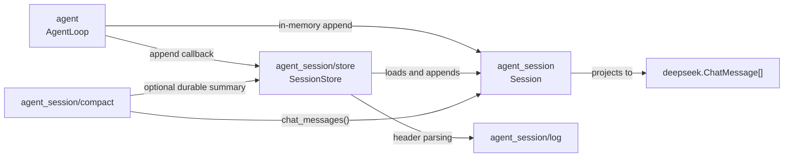
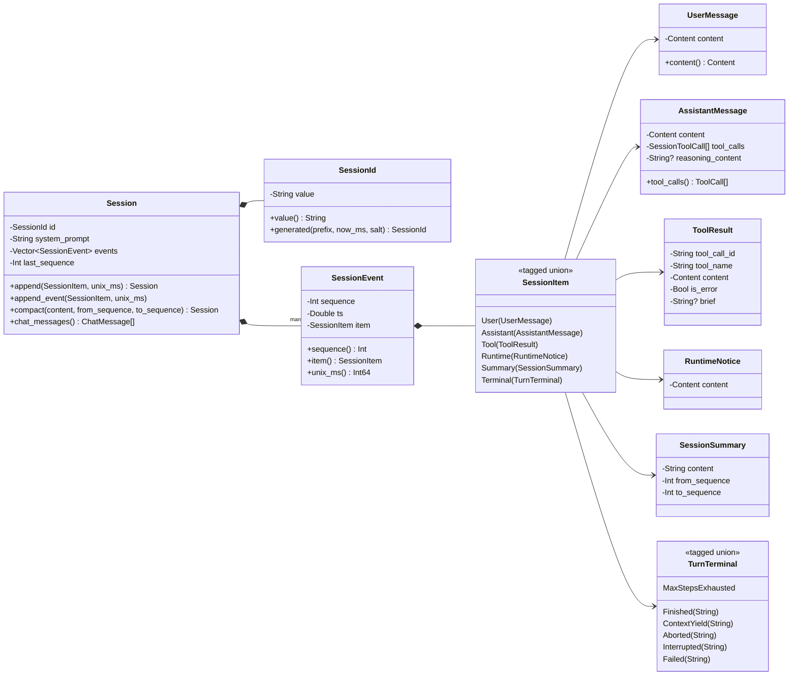
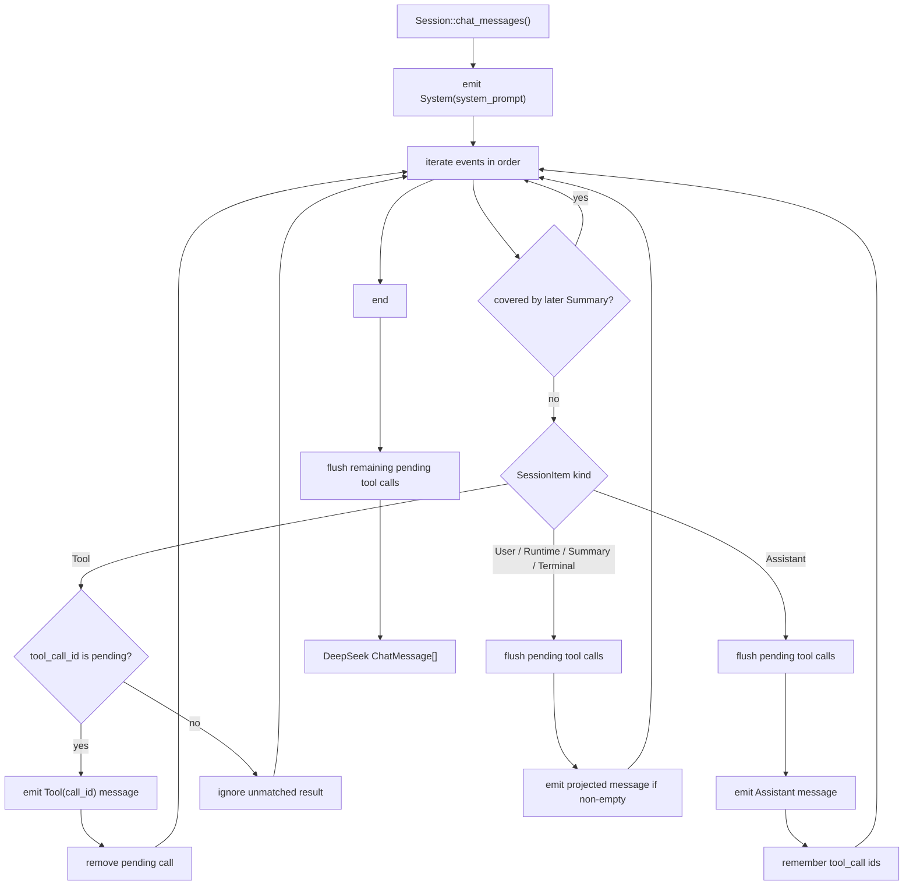
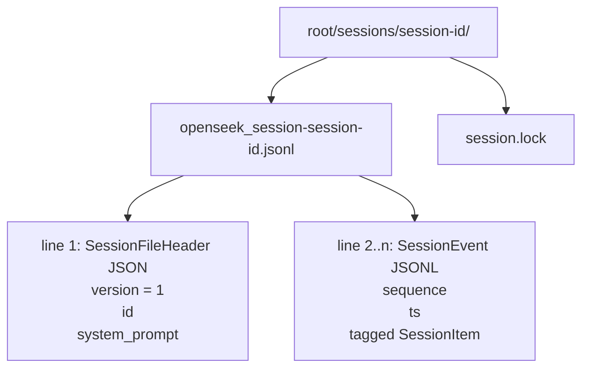
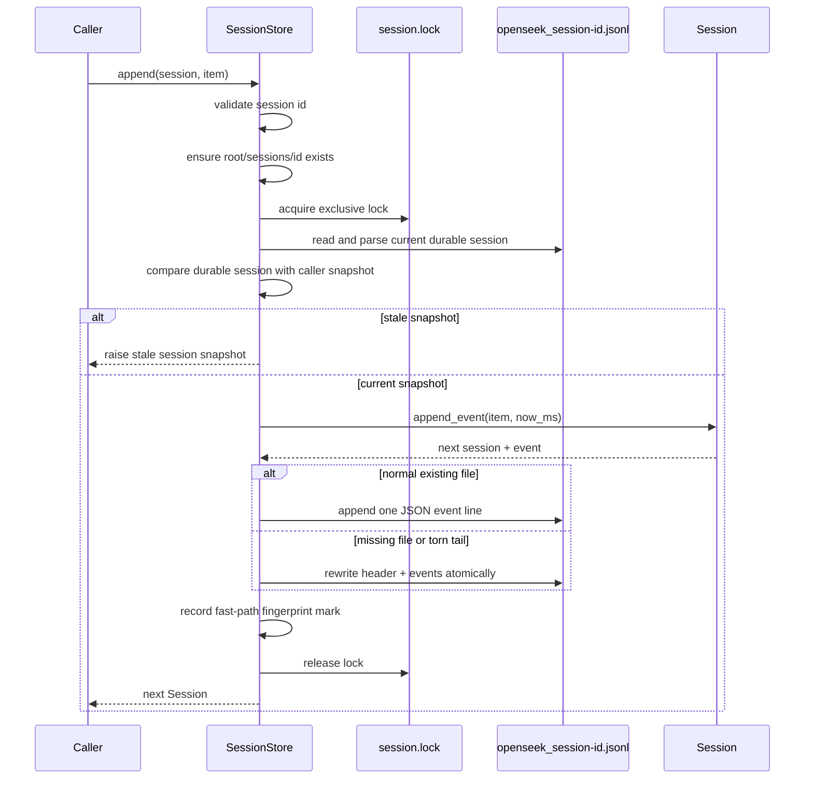

# OpenSeek Agent Session

`moonbitlang/openseek/agent_session` is the typed, provider-aware conversation
state for resumable OpenSeek agents. It owns the durable event log and the
projection from that log into model history before provider-specific request encoding.

It is intentionally separate from the TUI transcript model. A `Session` is the
canonical process-independent record of what happened; the TUI transcript is a
rendering concern optimized for terminal display.

## Data Model

The root value is an immutable `Session`:

- `SessionId`: stable id for a persisted conversation.
- `system_prompt`: fixed prompt captured when the session is created.
- `events`: append-only `SessionEvent` values in log order.
- `last_sequence`: highest event sequence, or `0` for an empty session.

Each event has a one-based monotonic sequence number, a unix-millisecond
timestamp, and one `SessionItem` payload:

- `User`: user-authored prompt or steering text.
- `Assistant`: model output, including native DeepSeek tool calls and optional
  reasoning content.
- `Tool`: local tool result for one assistant tool call.
- `Runtime`: runtime notice injected into model context, such as a plan reminder.
- `Summary`: durable compaction record for a covered event range.
- `Terminal`: how a turn ended: finished, yielded at the context ceiling,
  aborted, interrupted, out of steps, or failed.

Appending never mutates the receiver. It returns a new session that shares the
old log structure.

User and tool content uses ordered `Text`, inline `Image`, and durable
`ImageRef` parts. Text extraction excludes images. The agent admits initial
input, steering input, and tool results through the attachment store before
constructing their session items. The admitted content is shared by history
and the live model-request buffer; session append never transforms it.
Images retain their original PNG/JPEG/GIF/WebP bytes and the existing 5 MiB
limit; this path does not resize or transcode them.

New durable images have the form
`{"type":"image","attachment_id":"sha256:...","media_type":"image/png","bytes":123}`.
Their bytes live in the executing host's
`~/.openseek/attachments/v1/objects/<first-two-hex-digits>/<sha256>` and are shared
across sessions and worktrees. Hash, size and MIME are verified on read.
Legacy inline base64 records remain readable; migrate them explicitly with
`openseek sessions migrate-images <id> --dir <workspace>` to reduce existing
logs. Normal history reads do not rewrite files. Migration preserves sequences
and timestamps. Logs containing references use header version 2; readers
accept both versions 1 and 2. Single text content still serializes as a string.

`Session::chat_messages()` preserves order and projects references as internal
`openseek-attachment:` addresses. `deepseek/client` resolves those addresses
before encoding a provider request, uploading through the Files API and using
`File(file_id=...)`. Normal turns and compaction share this path. Legacy inline
records continue to use data URLs until migrated.

Upload mappings are persisted separately in
`~/.openseek/deepseek/files-v1.json`, scoped by a digest of endpoint and
credentials plus the image identity. Uploads request a one-day lifetime and
refresh when fewer than five minutes remain. A short file lock covers index
reread, merge and atomic replacement; it never covers network IO. Up to four
unique images per request upload concurrently. Concurrent duplicate uploads
reuse the committed winner; unused remote duplicates expire naturally.
Explicit provider file-not-found/expired/invalid-ID errors invalidate the exact
cached IDs and allow one refresh attempt, before any completion has started.
There is no automatic deletion of local shared attachments.

Desktop loads referenced thumbnails on demand from the owning authenticated
host. Message edits retain the reference. Forks share attachments without
copying them into worktrees. A raw JSONL is no longer a portable image bundle:
when moving it to another host, also copy the referenced attachment objects.
Standalone HTML exports embed image bytes to stay self-contained.

The agent loop and compaction call the provider client directly. Desktop
accepts selected, pasted, or dropped images, carries them through initial prompts,
steering and queued follow-ups, and renders thumbnails from durable history.
Rejected submissions restore their images to the owning conversation draft.

## Architecture Diagrams

The package split keeps the pure session model separate from native persistence
and agent runtime concerns:



The core data model is an immutable session with an append-only event log.
`SessionItem` and `TurnTerminal` are MoonBit enums with payloads, so the diagram
shows them as tagged unions instead of plain UML enumerations:



```mbt check
///|
test "append leaves the original session unchanged" {
  let session = @agent_session.Session(
    SessionId("example"),
    system_prompt="system",
  ).append(User(UserMessage(Content([Text("hello")]))))
  debug_inspect(
    session,
    content=(
      #|{
      #|  id: { value: "example" },
      #|  system_prompt: "system",
      #|  events: <Vector:
      #|    [
      #|      {
      #|        sequence: 1,
      #|        ts: 0,
      #|        item: User({ content: Content([Text("hello")]), submission_id: None }),
      #|      },
      #|    ]>,
      #|  last_sequence: 1,
      #|}
    ),
  )
}
```

Call `append_event` when the caller also needs the assigned `SessionEvent`, for
example before appending it to an on-disk JSONL log:

```mbt check
///|
test "append_event returns the durable event" {
  let session = @agent_session.Session(SessionId("s1"), system_prompt="system")
  let (next, event) = session.append_event(
    User(UserMessage(Content([Text("hello")]))),
  )
  debug_inspect(next.last_sequence(), content="1")
  debug_inspect(
    event,
    content=(
      #|{
      #|  sequence: 1,
      #|  ts: 0,
      #|  item: User({ content: Content([Text("hello")]), submission_id: None }),
      #|}
    ),
  )
}
```

## Model Projection

`Session::chat_messages` converts the durable session into the exact DeepSeek
messages sent to the model. Projection is where session-specific repair and
compaction rules are applied:

- The first message is always the stored system prompt.
- `User` and `Runtime` events become user messages.
- `Assistant` events preserve visible content, reasoning content, and native
  tool calls.
- `Tool` events are emitted only when they answer a pending assistant tool call.
- `Terminal(Finished(...))` becomes a final assistant message when non-empty,
  unless it repeats the immediately preceding Assistant message.
  `Terminal(ContextYield(...))` is run status and never reaches the model.
  Failed, out-of-steps, aborted, and interrupted terminals become
  assistant-status messages.
- A dangling assistant tool call is closed with a synthetic tool error before
  the next non-tool event, keeping the protocol-valid replay shape.



```mbt check
///|
test "project a session into DeepSeek messages" {
  let call = @deepseek.ToolCall(
    id="call_1",
    name="read",
    arguments="{\"path\":\"README.md\"}",
  )
  let session = @agent_session.Session(SessionId("s1"), system_prompt="system")
    .append(User(UserMessage(Content([Text("inspect")]))))
    .append(Assistant(AssistantMessage("", tool_calls=[call])))
    .append(
      Tool(
        ToolResult(tool_call_id="call_1", tool_name="read", content=[
          Text("README"),
        ]),
      ),
    )
    .append(Terminal(Finished("done")))

  let messages = session.chat_messages()
  debug_inspect(
    messages,
    content=(
      #|[
      #|  {
      #|    role: System,
      #|    content: Content([Text("system")]),
      #|    tool_calls: [],
      #|    reasoning_content: None,
      #|  },
      #|  {
      #|    role: User,
      #|    content: Content([Text("inspect")]),
      #|    tool_calls: [],
      #|    reasoning_content: None,
      #|  },
      #|  {
      #|    role: Assistant,
      #|    content: Content([Text("")]),
      #|    tool_calls: [{ id: "call_1", name: "read", arguments: "{\"path\":\"README.md\"}" }],
      #|    reasoning_content: None,
      #|  },
      #|  {
      #|    role: Tool("call_1"),
      #|    content: Content([Text("README")]),
      #|    tool_calls: [],
      #|    reasoning_content: None,
      #|  },
      #|  {
      #|    role: Assistant,
      #|    content: Content([Text("done")]),
      #|    tool_calls: [],
      #|    reasoning_content: None,
      #|  },
      #|]
    ),
  )
}
```

## Compaction

Compaction is append-only. `Session::compact` validates a source event range and
appends a `Summary` event; it does not delete or rewrite the raw event log.

Later, `Session::chat_messages` skips older events covered by a later summary
and emits the summary as a user message:

```text
[conversation summary]
source_events=<from>..<to>
<summary text>
```

```mbt check
///|
test "summary replaces covered events in model projection only" {
  let session = @agent_session.Session(SessionId("s1"), system_prompt="system")
    .append(User(UserMessage(Content([Text("old user")]))))
    .append(Assistant(AssistantMessage("old assistant")))
    .compact(
      content="old user and assistant discussed README",
      from_sequence=1,
      to_sequence=2,
    )
  debug_inspect(
    session,
    content=(
      #|{
      #|  id: { value: "s1" },
      #|  system_prompt: "system",
      #|  events: <Vector:
      #|    [
      #|      {
      #|        sequence: 1,
      #|        ts: 0,
      #|        item: User({ content: Content([Text("old user")]), submission_id: None }),
      #|      },
      #|      {
      #|        sequence: 2,
      #|        ts: 0,
      #|        item: Assistant(
      #|          {
      #|            content: "old assistant",
      #|            tool_calls: [],
      #|            reasoning_content: None,
      #|            is_replay: None,
      #|            usage: None,
      #|          },
      #|        ),
      #|      },
      #|      {
      #|        sequence: 3,
      #|        ts: 0,
      #|        item: Summary(
      #|          {
      #|            content: "old user and assistant discussed README",
      #|            from_sequence: 1,
      #|            to_sequence: 2,
      #|          },
      #|        ),
      #|      },
      #|    ]>,
      #|  last_sequence: 3,
      #|}
    ),
  )
  let messages = session.chat_messages()
  debug_inspect(
    messages,
    content=(
      #|[
      #|  {
      #|    role: System,
      #|    content: Content([Text("system")]),
      #|    tool_calls: [],
      #|    reasoning_content: None,
      #|  },
      #|  {
      #|    role: User,
      #|    content: Content([Text("[conversation summary]\nsource_events=1..2\nold user and assistant discussed README")]),
      #|    tool_calls: [],
      #|    reasoning_content: None,
      #|  },
      #|]
    ),
  )
}
```

## JSON And Storage

This package provides JSON round-tripping for `Session`, `SessionId`,
`SessionEvent`, and all session item variants. The nested native package
`moonbitlang/openseek/agent_session/store` owns filesystem persistence.

The store layout is:

```text
<root>/sessions/<session-id>/
  openseek_session-<session-id>.jsonl
  session.lock
```

`openseek_session-<session-id>.jsonl` holds the whole session: a header record
(`{"version":1,"id":...,"system_prompt":...}`) on the first line, then one
append-only event per line. Loading replays the event lines into a `Session`.

Every build must load the logs earlier builds wrote; the frozen
`store/testdata/session-v1.jsonl` pins that. Older builds are not expected to
read newer logs. Adding a kind, such as the `context_yield` and
`max_steps_exhausted` terminals, does not bump `version`: each line names its
own kind, and the decoder keeps reading the older encodings. A current
`finished` or `failed` message that reads like one of those encodings is saved
with `"verbatim": true` so it is not reinterpreted. `version` changes only when
the same bytes would mean something different.



Use the store for durable callers:

- `SessionStore::create`: write a complete session, replacing prior contents.
- `SessionStore::append`: append one item with a current timestamp.
- `SessionStore::compact`: append a validated summary event.
- `SessionStore::load`: replay a persisted session.
- `SessionStore::listings`: list ids with last-activity and first-prompt
  metadata.

## Runtime Flow

The `agent` package appends session events as the loop progresses:

1. The user task is appended as `User`.
2. Runtime notices may be appended as `Runtime`.
3. Model responses are appended as `Assistant`.
4. Tool executions are appended as `Tool`.
5. The turn closes with one `Terminal`.

The CLI and TUI decide whether those appends are in memory or durable. For
durable sessions, they pass an append callback backed by `SessionStore::append`
into the agent loop.



## Public API Surface

The package exposes:

- `SessionId` and immutable `Session`.
- `SessionEvent` sequence numbers backed by an immutable vector.
- Typed `SessionItem` variants for users, assistants, tool results, runtime
  notices, summaries, and turn terminal states.
- JSON round-tripping for durable storage.
- `Session::append_event` for callers that need the new session and appended
  event without scanning the whole log.
- `Session::chat_messages` for model projection.
- `Session::compact` for validated summary append.
- `Session::fork` for a new session, with a system prompt of its own, that
  starts from a state this one stood in: every finished turn, or the turns up
  to a chosen one.

```mbt check
///|
test "session JSON round-trips events" {
  let session = @agent_session.Session(SessionId("s1"), system_prompt="system")
    .append(User(UserMessage(Content([Text("hello")]))))
    .append(Terminal(Finished("done")))

  let decoded : @agent_session.Session = @json.from_json(Json(session))
  debug_inspect(
    decoded,
    content=(
      #|{
      #|  id: { value: "s1" },
      #|  system_prompt: "system",
      #|  events: <Vector:
      #|    [
      #|      {
      #|        sequence: 1,
      #|        ts: 0,
      #|        item: User({ content: Content([Text("hello")]), submission_id: None }),
      #|      },
      #|      { sequence: 2, ts: 0, item: Terminal(Finished("done")) },
      #|    ]>,
      #|  last_sequence: 2,
      #|}
    ),
  )
}
```
