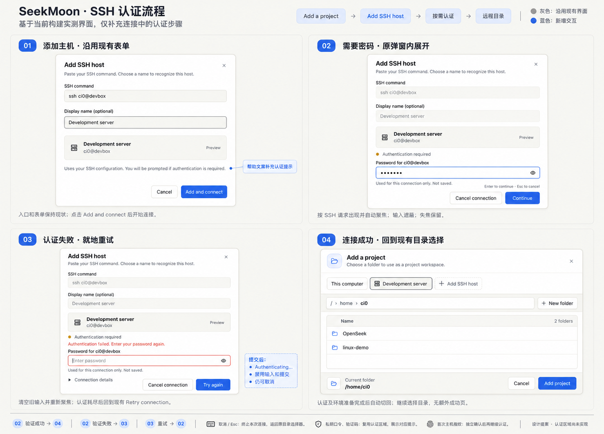
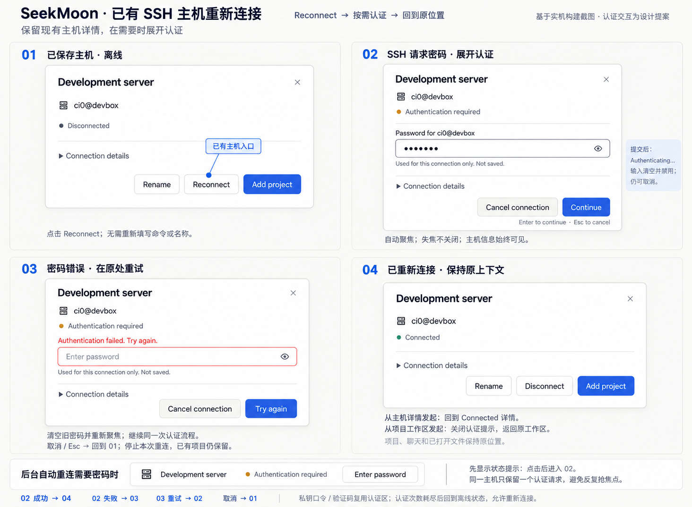

# SSH 交互认证设计与实现方案

状态：已实现；macOS 打包应用已完成真实交互认证验收，Linux / Windows 待平台验证。

日期：2026-10-19

范围：首次添加 SSH 主机，以及已保存主机重新连接时的交互认证。

在现有 SeekMoon 弹窗内增加按需认证，保留当前添加主机、主机详情和目录选择流程。密码只用于当前认证请求，不持久保存。连接成功后按发起连接的目的返回：添加项目进入远程目录选择，重新连接回到主机详情或原工作区。

两张设计图基于当前项目构建后的真实界面制作，认证区域属于待实现设计。图用于布局与视觉参考；状态、错误、取消和导航语义以本文为准。图中的示例主机、用户名和目录不进入产品默认值。

## 设计图

### 首次添加主机并认证



### 已保存主机重新连接并认证



## 实现前基线与参考依据

当前添加流程为 `Add a project → Add SSH host → Add and connect → 远程目录选择`。连接过程中保留添加表单，禁用命令与名称；失败在原处展示错误和 `Retry connection`。取消返回之前的目录选择器。主机配置在连接之前保存，因此连接取消后可能仍保留离线主机。

当前主机详情包含名称、地址、连接状态、`Connection details` 和操作按钮。点击 `Reconnect` 后原弹窗显示连接进度；成功后保持详情页，显示 `Connected` 和 `Disconnect`，不会自动打开目录选择器。

后端目前固定使用 `BatchMode=yes`，尚无向前端请求密码的通道。一次连接拥有用于启动远端服务的 SSH 进程，以及独立的 `ssh -N -L` 转发进程；认证必须覆盖两者。RPC 经 SSH 转发后的 WebSocket 传输，启动进程的标准输入输出已有协议用途。

参考 VS Code Remote SSH 的按需输入和不保存密码原则。其[官方说明](https://code.visualstudio.com/docs/remote/ssh#_remote-ssh-limitations)明确密码和其他认证 token 不保存，[认证问答](https://code.visualstudio.com/docs/remote/ssh#_can-i-sign-in-to-my-ssh-server-with-anotheradditional-authentication-mechanism-like-a-password)说明连接时自动提示输入。`ssh-agent` 中已解锁的密钥或 SSH 连接复用可能减少提示，并不等于保存服务器密码。本方案的原弹窗布局、后台提示和请求去重是对 SeekMoon 的设计，不宣称与 VS Code 界面完全一致。

## 首次连接流程

1. 从现有目录选择器进入 `Add SSH host`，保留 SSH command、可选 Display name、主机预览卡和当前排版。
2. 帮助文案改为 `Uses your SSH configuration. You will be prompted if authentication is required.`。点击 `Add and connect` 后仍显示当前表单，禁用命令与名称，展示连接进度。
3. 只有 SSH 真正请求用户输入时，才在预览卡下展开认证区域。无交互的密钥认证直接进入后续准备阶段。
4. 认证区域显示 `Authentication required`、对应请求的标签、遮蔽输入框、显示或隐藏按钮，以及 `Used for this connection only. Not saved.`。底部操作改为 `Cancel connection` 和 `Continue`，首次展开自动聚焦输入。
5. 提交后清空前端输入值，显示 `Authenticating…`，禁用重复提交，仍允许取消。若收到下一项认证挑战，在同一区域显示新请求。
6. 确认密码被拒绝且 SSH 仍允许重试时，在原区域显示 `Authentication failed. Enter your password again.`，清空并重新聚焦输入，按钮为 `Try again`。无法确认失败原因时保留 SSH 提示，不把所有新挑战都当作密码错误。
7. 认证后继续展示远端准备进度。只有远端服务及通信通道真正可用才进入当前远程目录选择器，继续选择目录、`Add project`；不增加成功确认页。
8. 取消、Esc 或关闭按钮终止本次连接，恢复进入前的目录选择状态。已保存的主机保留为离线，不隐式删除配置。

如果 SSH 已耗尽尝试次数或退出，结束本轮认证，回到当前失败状态和 `Retry connection`。再次点击重试创建新的连接尝试；不得在已经退出的进程上继续显示可提交的密码框。

## 已保存主机重新连接流程

1. 用户从现有主机详情点击 `Reconnect`，直接使用已保存配置。保留主机名称和地址，不回到添加主机表单。
2. 等待 SSH 时显示 `Connecting…`；需要输入时在详情中展开与首次连接共用的认证区域。认证过程中操作收敛为 `Cancel connection` 和 `Continue`，暂不显示 `Rename`、`Add project` 等无关操作。
3. 提交、后续挑战、错误重试和终止失败复用同一认证逻辑，不另做一套重连密码状态。
4. 成功从认证状态恢复为 `Connected`，按发起目的返回下表中的位置。
5. 取消、Esc 或关闭按钮终止本次尝试，回到离线状态；从详情发起的保留详情，从工作区发起的关闭认证层并回到原工作区。已有项目注册、聊天记录和打开文件的位置不因取消被清空。

| 发起目的 | 成功后的去向 | 取消或终止失败后的状态 |
| --- | --- | --- |
| 添加主机后添加项目 | 现有目录选择器，选中该远程主机 | 取消恢复原选择器；失败留在添加表单供重试 |
| 已有主机的 Add project | 现有目录选择器，选中该远程主机 | 回到原入口，保留主机配置 |
| 主机详情的 Reconnect | 同一详情，显示 Connected、Rename、Disconnect、Add project | 同一详情，显示离线、错误详情和重连操作 |
| 当前远程工作区的 Reconnect | 关闭认证提示，回到同一工作区并恢复合理焦点 | 同一工作区，显示离线和重连入口 |
| 后台重连请求 | 保留当前页面，仅更新状态 | 保持离线或失败状态，等待用户操作 |

“保留上下文”指前端导航、项目和历史记录。当前实现中连接关闭会结束其拥有的远端服务、运行任务和 PTY；本功能不承诺它们跨断线存活，也不自动重放未确认成功的写操作或重新启动用户任务。

后台连接需要输入时，先显示带主机名称的 `Authentication required` 状态和 `Enter password` 操作，点击后才打开认证区域，不主动抢焦点。同一主机同一轮连接只有一个待处理认证流程。若当前没有后台自动重连入口，不为此功能新增重连调度器；此规则约束已有或后续接入的后台入口。

## 认证区域和视觉规则

复用当前弹窗、输入框、按钮、服务器图标和状态点。以现有 `.ssh-modal` 的 480px 宽度、24px 内边距和全局圆角为基础；小窗口限制最大高度并允许内容滚动。使用现有主题变量，保持浅色暖灰背景、细边框、蓝色主按钮、红色错误文本及清晰焦点边框，不把图中标注箭头或说明框做进产品。

| 状态或请求 | 标签和操作 |
| --- | --- |
| 服务器密码 | `Password for {user@host}`；默认遮蔽 |
| 私钥口令 | `Passphrase for {key}`；默认遮蔽 |
| 验证码或其他挑战 | 使用实际 SSH 提示，无法识别时使用通用认证标签；敏感值默认遮蔽 |
| 等待输入 | Authentication required；Cancel connection / Continue |
| 等待验证 | Authenticating…；清空输入、禁用重复提交、保留取消 |
| 可以继续重试 | 就地错误、空输入框、重新聚焦；Cancel connection / Try again |
| SSH 退出或网络失败 | 结束输入状态，显示连接错误和重试连接入口 |

主机卡始终标识用户正在连接的配置。请求来自跳板机或特定密钥时，认证标签应准确展示可获得的请求对象；无法可靠识别时显示原始提示，不根据配置地址编造目标。所有提示按文本渲染。

Enter 提交当前有效请求；Esc、关闭按钮和 `Cancel connection` 具有相同取消语义。切换应用、失焦或点击遮罩不应关闭正在进行的认证。关闭后把焦点交还发起入口；错误与阶段变化通过合适的辅助技术状态提示播报。显示密码按钮需有可访问名称和明确状态，新请求默认重新遮蔽。

首次主机指纹确认使用独立的确认状态，展示 SSH 提供的主机、指纹和信任提示，提供接受与取消操作。它不是密码框，不能混入密码错误重试。遵循 OpenSSH 的 known_hosts 行为，不使用自动接受或跳过校验来绕过交互；已知主机指纹变化按 SSH 错误处理。

## 状态与协议约束

连接生命周期和当前可见弹窗分开管理。建议每个主机维护连接尝试、当前请求、发起目的和可恢复的入口上下文，认证区域只呈现选中的请求。

```text
离线 → 连接中 → 等待认证 → 验证中 → 远端准备 → 已连接
                 ↑          │          │
                 └─后续挑战─┴──────────┘

任意进行中状态 → 用户取消 → 离线
任意进行中状态 → 进程退出或连接错误 → 失败，可新建连接尝试
```

后续挑战可能来自另一个 SSH 进程、跳板机、多因素验证或再次尝试。只有明确的拒绝信息才显示“认证失败”。不固定假设一次连接只输入一次密码，也不自行设置与 OpenSSH 不一致的重试次数。

| 数据 | 语义 |
| --- | --- |
| host_id | 保存的主机身份 |
| epoch / attempt | 本轮连接身份，覆盖启动和转发阶段 |
| request_id | 本轮中唯一的交互请求身份 |
| kind / prompt | 密码、私钥口令、其他挑战或主机确认，以及展示文本 |
| target | 可可靠获得的认证目标；无法获得时使用可选值 |
| intent | 添加项目、详情重连、工作区重连或后台连接 |
| response | 明确区分提交值、接受确认与取消 |

具体类型和命令名由实现结合仓库惯例确定，但必须满足以下行为：

- 后端通过现有本地桥接事件发出请求；响应命令明确走 Local，不通过尚未连接的远程路由。原生端在接收时校验 host、attempt 和 request_id 仍匹配当前等待者。
- 取消、新连接、窗口关闭或页面重载使旧请求失效。晚到的输入、失败或成功事件不得改变新连接，也不得打开旧目录选择器。
- 连续点击连接或重复事件不能创建多个密码框或多个提交。UI 禁止进行中重复操作；原生端对同一进行中连接的重复发起复用现有尝试。显式取消后重试才开始新尝试。
- 同一主机的挑战依次处理；不同主机的请求分别保存身份，只显示用户选择的认证流程，后台请求不覆盖正在输入的请求。
- 缺少请求用 Option 或枚举表达；错误用明确错误通道或 tagged case。取消不能借用空密码、空字符串或异常文本表达。空值是否可提交遵循对应挑战的契约。
- 修改协议时同时更新前端、原生端和显式 JSON codecs，明确缺失、null、未知和错误类型字段的处理。桌面前后端一起发布，不额外构建混合版本兼容层。

## 后端接入建议

优先验证 OpenSSH 的 askpass helper 与应用本地 IPC 方案：helper 将提示交给拥有连接的后端，再通过前端获取响应。确认目标平台的 `SSH_ASKPASS` 和 `SSH_ASKPASS_REQUIRE` 支持及打包路径后落地；只去掉 `BatchMode=yes` 不足以完成交互。

保留启动协议使用的 stdin/stdout，不向其中写入密码。askpass 的返回通道与启动协议分离；密码不得进入进程参数、环境变量、配置文件、日志、错误详情或可持久化的 UI 快照。IPC 绑定到本应用拥有的连接尝试和等待者，取消或退出时关闭等待者及相关 helper。

启动 SSH 与转发 SSH 都必须接入认证。如果两者分别发起挑战，就在同一 UI 中顺序处理并保留准备进度；不把第一次认证成功当作最终 Connected。此版不引入跨请求密码缓存，也不自动复用验证码。避免为减少提示顺带重构为常驻 SSH daemon 或新增凭据管理器。

前端提交后立即清空表单状态，后端交付响应后释放不再需要的引用，取消和断线时清除待处理值。不宣称运行时可保证所有内存副本立即物理清零。持久主机配置仍只包含连接配置和展示信息，没有“记住密码”开关。

认证等待应有清晰的生命周期：在用户输入期间显示等待认证状态，不能错误地显示一直在下载或连接；用户取消立即终止本次尝试。服务器超时或 SSH 退出后必须关闭失效输入并给出真实错误。若加入应用侧等待期限，应显示对应超时原因并允许重新连接，不能伪装成密码错误。

## 实现入口

以下路径相对于本文件，可直接跳转。实现前重新检查所在分支的代码与适用 AGENTS.md。

| 文件 | 改动职责 |
| --- | --- |
| [frontend/ssh.mbt](../../desktop/frontend/ssh.mbt) | SshUi、SshMsg、ssh_modal、连接目的、认证区域、取消与返回位置 |
| [frontend/interop/ssh.mbt](../../desktop/frontend/interop/ssh.mbt) | 沿用远程路由 epoch 与过期事件约束 |
| [project_picker/state.mbt](../../desktop/frontend/project_picker/state.mbt) / [view.mbt](../../desktop/frontend/project_picker/view.mbt) | 保留现有目录选择状态及入口，按需接入 |
| [styles/base.css](../../desktop/styles/base.css) | 基于当前 SSH 样式和主题变量增加认证区域 |
| [protocol/ssh.mbt](../../desktop/protocol/ssh.mbt) / [commands/ssh.mbt](../../desktop/commands/ssh.mbt) | 交互请求、响应及 codecs |
| [app/internal/extension/extension.mbt](../../desktop/app/internal/extension/extension.mbt) | 本地命令端点、连接任务、epoch、生命周期与响应路由 |
| [app/internal/extension/ssh.mbt](../../desktop/app/internal/extension/ssh.mbt) | 现有 ssh.event 事件声明 |
| [backend/ssh/connection.mbt](../../desktop/backend/ssh/connection.mbt) | 启动与转发进程、认证等待、清理和错误传播 |
| [backend/ssh/command.mbt](../../desktop/backend/ssh/command.mbt) | 交互所需 SSH 参数；保留参数解析约束，不改成任意 shell 执行 |
| [backend/ssh/store.mbt](../../desktop/backend/ssh/store.mbt) | 保持无密码的持久化配置 |
| [backend/ssh/README.md](../../desktop/backend/ssh/README.md) | 更新认证支持、限制和实际验证方法 |

当前 `pick_after_connect` 主要表示连接后打开目录选择，`return_picker` 保存前一个选择器。实现应明确区分不同连接目的，避免所有认证成功都走添加项目路径。当前普通弹窗 Close 行为也不等同于取消详情中的重连，不能直接复用而漏掉原生任务清理。

后端认证逻辑保持独立于 Proton；只有窗口桥接和打包接线放在 `desktop/app` 等适当宿主层。具体 helper 文件位置在确定实现后补充，不凭设计稿创建与项目架构无关的服务。

## 实施顺序与验收

先打通后端挑战、响应和取消的真实链路，再把同一认证组件接入首次连接与重新连接。随后验证多次挑战、过期事件和导航，最后补齐样式、键盘行为、文档和构建产物中的 helper。不要用固定密码提示或 mock 成功代替真实 SSH 验收。

| 场景 | 必须验证的结果 |
| --- | --- |
| 已可用密钥 | 不出现密码框；原添加项目和重连流程继续工作 |
| 首次密码连接 | 原添加弹窗展开认证；真实连接就绪后进入远程目录选择 |
| 已保存主机重连 | 不重复填写配置；成功回到详情；不自动打开目录选择 |
| 工作区重连 | 成功返回同一工作区；取消保留原项目、历史和文件位置 |
| 错误密码后成功 | 明确失败才显示错误；输入清空、聚焦、可重试；服务端退出后只能重新连接 |
| 私钥口令、验证码和连续挑战 | 标签正确、请求逐一提交，不把新挑战误认为密码错误 |
| 启动和转发分别要求认证 | 两阶段都可完成；转发未就绪前不显示最终成功 |
| 指纹确认与变化 | 独立确认；取消终止；变化错误不被自动接受 |
| Enter、Esc、关闭、失焦、遮罩 | 提交只发生一次；三种显式取消有效；失焦和遮罩不丢失输入流程 |
| 提交中取消或进程退出 | 无悬挂 helper 和等待者；没有仍可操作的过期输入框 |
| 取消后立即重试，旧事件晚到 | 旧响应和旧成功被拒绝，不影响新连接或导航 |
| 重复连接及多主机请求 | 不重复弹框；请求不会跨主机或跨尝试提交 |
| 后台入口需要输入 | 先显示状态和操作；不抢焦点，不无限弹窗 |
| 存储和日志检查 | 主机配置、日志、错误详情和 UI 持久化中没有输入的秘密值 |
| 小窗口及长提示 | 输入、错误、操作可见且可滚动，键盘顺序合理 |

自动化测试重点覆盖协议解码、请求身份、取消清理、过期事件、重试和不同 intent 的导航结果，选择能发现真实回归的断言。真实密码、私钥口令和两段 SSH 的行为使用受控 SSH 服务验收，不能只靠前端 mock。

按仓库要求执行 `moon info && moon fmt` 并检查接口 diff，以及根目录 `just check`、`just test`、`just build`。仅当改动涉及 editor 实现时追加其相应测试要求。遵循 [Desktop 规则](../../desktop/AGENTS.md)，用打包后的开发应用验证宿主与 helper：

```sh
moon -C desktop run --target native package/macos -- --target app --no-open
codesign --verify --deep --strict desktop/dist/SeekMoonDev.app
```

开发包的可执行文件为 `desktop/dist/SeekMoonDev.app/Contents/MacOS/seekmoondev`。按平台实际支持范围验证 helper，不能只因 macOS 上可用便宣称全部平台完成。最终交付包含两条真实密码流程的截图或录像、通过的检查，以及尚未通过的具体场景。实现截图按 Desktop 规则留在仓库外或忽略目录；本文保存的两张 PNG 是用户要求保留的设计资产。

## 实现前的基线验证（历史记录）

2026-10-19 已在当前工作树构建 `SeekMoonDev.app`，上述打包和签名检查通过。真实应用在 1120 × 760 窗口中验证了添加主机、连接中、认证拒绝、成功后的远程目录选择，以及已有主机重连成功后停留详情和取消回到离线；受控运行未发现页面错误或控制台警告、错误。

基线 SSH 服务只提供公钥认证。通过禁用公钥认证观察到 `Permission denied (publickey)` 和 `ReaderClosed`，这仅证明当前失败路径；尚未验证本方案的真实密码登录。两张图中的密码输入、就地重试和后台认证提示仍待实现。接手 agent 必须准备支持密码认证的测试服务补齐验证。

## 原始实现任务

> 请阅读本设计方案、两张设计图和适用的 AGENTS.md，在现有 SeekMoon SSH 流程中实现按需交互认证。保留首次添加与已有主机重连的不同返回路径，密码不持久保存。覆盖启动 SSH 和转发 SSH，正确处理取消、连续挑战、过期事件和真实错误。先检查当前源码，再实现和验证，不增加常驻远程 daemon、凭据保存或无关重构。用打包开发应用及真实密码认证服务完成两条流程验收，并报告检查结果和剩余限制。


## 实现记录（2026-10-19）

### 交付内容

- 新增 `SshConnect`、`SshEvent` 和认证请求/响应的显式 JSON codecs；Local `ssh.auth.respond` 同时校验 host、attempt、native epoch、request 和响应种类。提交值、接受指纹和取消是独立枚举。
- `backend/ssh/auth.mbt` 实现按连接拥有的 loopback IPC；随机 capability 绑定 helper。应用以同一个已签名可执行文件运行 askpass 入口，在日志、参数解析和 Proton 初始化之前处理，不依赖额外 helper 文件或解释器。
- 启动和转发 SSH 均使用强制 askpass，保留各自 stdin/stdout 协议。主机校验使用 `StrictHostKeyChecking=ask`。每阶段总等待上限 20 分钟；转发就绪计时排除当前输入等待。进程退出、取消、重载和窗口关闭清理任务与等待者。
- 同一认证区域支持密码、私钥口令、实际 keyboard-interactive 提示及独立指纹确认。只有明确拒绝才标记密码重试；耗尽尝试后只提供新连接入口。
- 按主机保存认证身份与连接目的；首次添加、已有主机添加项目、详情重连、工作区重连和后台请求分别返回原定位置。后台请求不抢焦点，没有新增调度器。
- 秘密值只保留在当前 DOM 输入框和一次性交付中，不进入前端 model、消息历史或主机配置；提交、取消和新请求清空，默认遮蔽。固定弹窗渲染位置，避免响应式布局重建输入节点。关闭后恢复原入口焦点。

### 自动检查

执行 `moon info && moon fmt`，检查生成接口的差异仅涉及上述协议和 helper 接线。根目录 `just check`、`just test`、`just build` 通过：native 3793/3793、JS 3849/3849、离线 cram 85/85，附加 CLI 集成脚本通过。最终测试结果及完整日志保留在 `/tmp/ssh-auth-*-verified.log`；未修改 editor 实现。

开发包命令和签名检查：

```sh
moon -C desktop run --target native package/macos -- --target app --no-open
codesign --verify --deep --strict desktop/dist/SeekMoonDev.app
```

### 真实桌面与 SSH 验收

使用 `desktop/dist/SeekMoonDev.app/Contents/MacOS/seekmoondev`，通过 CDP `127.0.0.1:9368` 附加实际 `https://proton.localhost/index.html` 页面。测试服务为独立 loopback SSH 服务（127.0.0.1:22488），提供密码、加密私钥和 keyboard-interactive 认证，并执行真实 bootstrap、转发和 app-server；没有模拟连接成功事件。应用 HOME、主机配置及 known_hosts 均隔离在 `/tmp/seekmoon-auth-qa`，远端 CLI 使用当前构建预先准备，不重复测试下载发布流程。

| 场景 | 结果 |
| --- | --- |
| 首次主机信任 | 显示实际指纹和独立 Accept；接受后才请求密码；Esc 取消回离线 |
| 错误密码后成功 | 清空、聚焦、显示 Try again；随后完成启动与转发两次认证，进入远程目录选择 |
| 已保存主机详情重连 | 两阶段真实密码认证后仍在详情，无目录选择器；已注册 demo-project 保留 |
| 工作区重连及取消 | 成功关闭认证层；取消保留原工作区及离线重连入口 |
| 密钥认证 | 加密私钥两阶段均显示真实 key 路径；未加密私钥成功且未创建输入框 |
| 验证码 | 两阶段均显示 SSH 的实际 Verification code 提示，无伪密码错误 |
| 输入与布局 | 默认遮蔽，显示按钮有状态；Enter 在显示按钮上不提交；遮罩保留输入；560 × 480 可滚动至输入和按钮，缩放保留同一输入节点和值 |
| 认证等待 | 转发阶段等待输入超过 20 秒仍可完成，未被 15 秒就绪期限误终止 |
| 取消与重试 | Esc、关闭按钮、Cancel connection 终止尝试；首次添加回到原选择器并恢复 Add SSH host 焦点；详情回离线；取消后立即新尝试可成功 |
| 耗尽密码尝试 | SSH 退出后移除输入框，只提供 Retry connection |
| 进程退出 | 终止测试应用拥有的等待认证 SSH 后，输入消失、原入口显示错误，无悬挂 helper |
| 指纹变化 | 仅修改隔离 known_hosts；拒绝并显示 OpenSSH 变化错误，无 Accept 或密码框；测试后恢复文件 |
| 页面重载 | 等待输入时重载，输入和全部连接拥有的 SSH/helper 均清理 |
| 多主机、后台和过期请求 | 自动化状态及 IPC 测试覆盖并发身份、后台不抢焦点、重复提交、晚到事件和旧取消不能关闭新连接 |
| 凭据残留 | 扫描 78 个隔离应用状态、profiles、Proton 日志文件，无测试密码、私钥口令或验证码；5434 个静态插件发行文件排除在状态扫描之外 |

页面和控制台未记录错误或警告。快速断开时可以看到现有的 retired-connection 操作错误提示；它表示旧操作被拒绝，不被当作新连接认证失败。未重构工作区恢复机制或重放操作。

已检查以下真实应用截图，均在仓库外；本文原有设计 PNG 保留：

- `/tmp/seekmoon-auth-qa/final-host-confirmation.png`：实际主机指纹确认。
- `/tmp/seekmoon-auth-qa/final-initial-auth.png`：首次连接的真实密码拒绝和就地重试。
- `/tmp/seekmoon-auth-qa/final-initial-connected.png`：两阶段完成后的远程目录选择。
- `/tmp/seekmoon-auth-qa/final-reconnect-auth.png`：已保存主机重连的认证区域。
- `/tmp/seekmoon-auth-qa/final-reconnect-connected.png`：重连成功后保留详情与 demo-project。
- `/tmp/seekmoon-auth-qa/final-small-window.png`：小窗口滚动后的输入和操作。

测试结束后已关闭 CDP 连接及受控应用，停止测试 SSH 服务；9368、22488 无监听，应用 helper、SSH 和测试远端进程无残留。最终两条密码流程截图来自错误正文修正后的重新打包版本。

### 未宣称覆盖的范围

Linux / Windows 打包及系统 OpenSSH、硬件安全密钥/FIDO、真实跳板机链和外部 MFA 提供商未实机验证；提示分类有相应单元覆盖。OpenSSH 客户端需支持 `SSH_ASKPASS_REQUIRE`（8.4 起）。20 分钟应用期限有明确错误正文，但未通过真实等待 20 分钟验收。后台入口的行为已实现并做状态测试，当前没有新增自动重连调度器。远端任务、PTY 和编辑器状态跨断线恢复不在本次范围。

### 新增和扩展测试质量

| Test / behavior | Score | Layer and cost | Regression caught | Decision |
| --- | ---: | --- | --- | --- |
| Authentication codecs | 4 | Pure protocol unit, fast | Empty value confused with cancel; missing/null/malformed/unknown tags accepted | Keep |
| Missing helper failure | 3 | Native connection lifecycle, no subprocess | Useful error reason lost through Error erasure; failed connection remains active | Keep |
| Prompt classification | 3 | Pure native unit, fast | Jump-host/key target mislabeled; OTP or confirm wrongly marked password retry | Keep |
| Waiter identity and answer kind | 4 | Native state test, fast | Cross-host/attempt/epoch/request response, duplicate consumption, cancellation leaving waiter live | Keep |
| IPC ownership and sequential challenges | 4 | Isolated loopback sockets, bounded, no SSH process | Unauthenticated local peer gets a prompt; sequential waiter/cancel handoff breaks | Keep |
| Duplicate connect after readiness | 4 | Existing frontend state case extended, fast | Late double click clears a ready route while native reuses it | Keep |
| Frontend duplicate/late requests | 4 | Pure frontend state test, fast | Duplicate submit/event reopens a consumed challenge; old success/error affects retry | Keep |
| Foreground reconnect intents | 4 | Parameterized frontend state test, fast | Details reconnect opens a picker; workspace reconnect keeps an unwanted modal | Keep |
| Multiple-host authentication | 4 | Pure frontend state test, fast | Background host replaces selected input, hides revealed input, or receives the wrong submit | Keep |
| Existing-host Add project return | 4 | Parameterized frontend state test, fast | Cancel/failure loses original picker/details or leaves a live input | Keep |
| Delayed native cancel | 4 | Native actor state test, fast | Cancellation from the previous attempt closes the replacement route | Keep |

All score-4 cases protect distinct lifecycle or protocol boundaries, assert observable state/results, and avoid timers except the IPC test's failure deadline. Existing unchanged cases were not audited. Retained: 11 semantic cases (10 new, 1 extended); avoided/deleted/replaced/consolidated/unscored: 0.


## 2026-10-21 提交前复核

将剩余实现拆为两个提交：远端安装与启动修复、SSH 交互认证。前者在独立工作树验证，后者在完整工作区验证；均执行 `moon info && moon fmt`、`just check`、`just test`、`just build`。

- 安装与启动修复：native 3823/3823、JS 3923/3923、cram 87/87，后续集成脚本及两目标构建通过。
- 完整工作区：native 3829/3829、JS 3928/3928、cram 87/87，后续集成脚本及两目标构建通过。
- 首次全量测试分别在未改动的图片上传 100ms 超时用例、后台任务输出快照用例中失败；两者各自单独复跑及对应完整测试复跑均通过，未修改这些用例或其实现。日志保留为 `/tmp/ssh-remaining-test.log`、`/tmp/ssh-remaining-test-retry.log`、`/tmp/ssh-bootstrap-test.log`、`/tmp/ssh-bootstrap-test-retry.log`。

本轮以 `moon -C desktop run --target native package/macos -- --target app --no-open` 重新生成 `desktop/dist/SeekMoonDev.app`，`codesign --verify --deep --strict` 通过。通过 CDP `127.0.0.1:9368` 附加 `https://proton.localhost/index.html`；本地隔离 SSH 服务监听 `127.0.0.1:22489`，远端使用当前构建预先准备的 v0.7.1 CLI 与 app-server。本轮未重新验证外部发布站点下载。

真实流程复核覆盖首次指纹确认、错误密码后清空输入并重试、启动及转发两阶段认证、成功后的远端目录浏览、详情重连取消、取消后再次重连成功并保留详情、密码显示切换，以及 560×480 认证弹窗布局与输入保留。页面 console/page 错误均为零；本轮检查的 Proton 和应用日志无 WARN/ERROR 条目。扫描隔离状态目录及 profiles 共 5512 个文件，未检出本轮三个测试密码/输入值。

本轮视觉检查图片均在仓库外：

- `/tmp/seekmoon-auth-commit-qa/initial.png`
- `/tmp/seekmoon-auth-commit-qa/host-confirmation.png`
- `/tmp/seekmoon-auth-commit-qa/password-retry.png`
- `/tmp/seekmoon-auth-commit-qa/connected.png`
- `/tmp/seekmoon-auth-commit-qa/reconnected.png`
- `/tmp/seekmoon-auth-commit-qa/small-window.png`

已关闭 CDP、测试应用和本地 SSH 服务，确认 9368/22489 无监听且测试应用/helper/SSH 命令无残留。此复核不替代上文列出的跨平台、外部 MFA 或真实跳板机覆盖限制。

安装与启动部分的新增或扩展测试评估：

| Test / behavior | Score | Layer and cost | Regression caught | Decision |
| --- | ---: | --- | --- | --- |
| Default bootstrap release and legacy alias | 4 | Pure command construction, fast | Fixed old release survives a version bump; saved openseek alias stops selecting automatic setup | Keep |
| Download, setup and versioned cache reuse | 4 | Local shell fixture with real curl/tar, bounded | Wrong cache version or obsolete CLI app-server wrapper; reconnect downloads again | Keep |
| Explicit app-server path takes no subcommand | 3 | Existing literal credential shell test, bounded | An app-server executable incorrectly receives the app-server CLI argument | Keep |

两个 score-4 用例分别保护版本/兼容性契约和安装缓存生命周期；其余仅修改测试数据或启动路径的既有用例未扩大审计。安装部分保留 3 项语义用例（1 新增、2 扩展），认证部分保留上表 11 项；合计保留 14 项，避免/删除/替换/合并/未评分均为 0。
