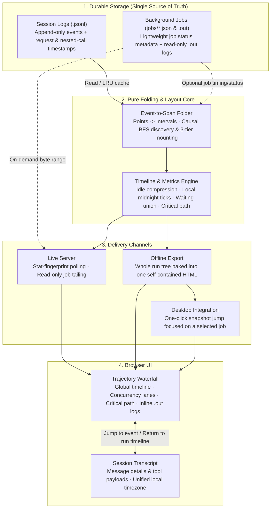

# OpenSeek Trajectory View — Design Overview

> **TL;DR:** Trajectory View folds a multi-agent run's scattered `.jsonl` session logs and background job outputs into a single causal waterfall timeline. It reveals **where wall-clock time went, who spawned whom, and what blocked what**—with near-zero write-path overhead and strict read-only safety.

---

## 1. The Problem: Transcripts Flatten Concurrency

A single-agent session is a conversation; a multi-agent run is a **distributed execution tree**.

Reading `.jsonl` transcripts sequentially breaks down in three ways:
1. **Lost causality:** A parent spawns three subagents in parallel, each writing to its own file. Linear logs cannot show concurrency or which step triggered which child.
2. **Opaque orchestration:** Workflow scripts (`.mbtx`) invoke host tools and nested subagents inside a single script call. Without unfolding those nested calls, a 40-second bottleneck looks like a single black box.
3. **Distorted time:** Discrete log events have timestamps, not durations. Worse, overlapping background jobs and blocking `job_wait` calls make it impossible to tell inference time apart from idle waiting.

### Three Design Invariants

1. **Fold at read time; write only what cannot be reconstructed.**
   If a relationship or duration already exists in the durable logs, compute it when rendering. We added only two timestamps to the write path—LLM request start time and nested script call start/end times—so legacy logs render cleanly with zero migration.
2. **One pure core, three delivery surfaces.**
   A single pure folding-and-layout engine powers the live server, standalone offline exports, and one-click jumps from the Desktop app. All three agree on every number and pixel.
3. **Read in the browser, mutate in the desktop.**
   Observation tools never write locks or state into active session directories. Viewing trajectories and tailing `.out` job logs stay strictly read-only in the browser; stopping jobs stays in the Desktop app.

---

## 2. System Architecture

---

## 3. How It Works

### 3.1 Turning Event Points into Honest Intervals

Logs record *instants* (when a message landed); humans debug *intervals* (how long a step took). A single pass folds each session's event stream into typed spans (`Run`, `Turn`, `LlmCall`, `ToolExec`, `WorkflowScript`, `PtcToolCall`, `BackgroundJob`, `JobWait`).

Two principles keep the timeline truthful:
- **No fabricated precision:** Older logs lack timestamps for nested script calls. Rather than guessing by dividing the outer script's duration evenly—which invents fake bottlenecks—we render untimed calls as honest zero-width markers.
- **Accurate job bounds with graceful fallback:** Session logs alone lack a standalone job completion event; when a store is present (live server or full exports), lightweight job-record metadata (`started_at_ms`, `finished_at_ms`, terminal status) supplies exact completion times and outcomes—even when `job_wait` ran much later or never ran. When no job store is available (such as a single dropped `.jsonl` file), folding falls back to `.jsonl` wait observations, and truly open unwaited jobs still do not keep finished runs perpetually live.

### 3.2 Reconstructing "Who Spawned Whom" Across Files

Discovering and attaching child lanes happens in two stages:

1. **Causal tree discovery:** Starting from the root session, a breadth-first search follows explicit child session references inside tool results (including nested script calls and recovered worker records) within the same store directory, backed by legacy child-naming patterns as a fallback. Store-level isolation prevents identically named sessions from other workspaces from leaking in.
2. **Three-tier mounting:** Hanging every child under the parent *turn* blurs concurrent spawns. Instead, each child attaches at the most specific level available:
   - **Exact (`tool_result`):** When a spawn result names its child session, the child mounts directly beneath that specific tool or nested script call.
   - **Time window (`time_window`):** For older logs lacking explicit child IDs, we match parent spans whose time window covers the child's start—preferring delegation/wait tools over concurrent leaf tools like `read_file`—and falling back to a covering parent turn only if no tool wraps it.
   - **Run fallback (`run_span`):** Orphaned workers recovered from an earlier engine instance whose timestamps predate current turns mount directly to the root `Run` instead of being misfiled under the final turn.

### 3.3 Making Overnight Runs Readable and Concurrency Numbers Honest

Real agent runs break naive linear charts in two ways: overnight pauses turn active work into 2-pixel slivers, and concurrent waits inflate summed durations.

- **Non-linear idle compression:** By default, gaps between active intervals are collapsed into narrow hatched slots (capped at 20% of active width) labeled with their true duration (e.g., `idle 8h 12m`). Users see the pause without losing resolution on the work—and can toggle back to true wall-clock scale locally in one click.
- **Waiting-time union:** If a `job_wait` overlaps two concurrent 700ms jobs, the real wall-clock wait is ~700ms—not 2,100ms. The `waiting` metric merges all `BackgroundJob` and `JobWait` intervals before summing, so sub-metrics never exceed total runtime.
- **Pragmatic critical path:** Without a full dataflow dependency graph, we define the critical path as the **longest single non-container step** (including actively running steps, excluding unwaited jobs) **plus its ancestor chain**. It immediately surfaces what actually slowed the run down.
- **Unified local timezone:** Both the waterfall scale (aligned to local midnight) and the session transcript view format timestamps in the browser's local timezone, preventing jarring UTC jumps when drilling from a waterfall row into its log.

### 3.4 Stat-Fingerprint Polling Instead of SSE

Rather than maintaining stateful SSE connections and incremental patch reducers, live observation uses **snapshot polling with a lightweight file-fingerprint cursor**:

- The server hashes the participating `.jsonl` files and lightweight job-record files' paths, modification times, and byte sizes into a short token, keeping parsed logs in a bounded LRU cache.
- On each poll, if every file's `stat` matches the cursor, the server replies `unchanged` with **zero file reads**. If one file grew, only that file is re-parsed. If any file fails to read, a `-partial` cursor forces a full re-check on the next tick.
- Background `.out` logs (which can reach tens of megabytes) are served strictly read-only via a 64 KiB tail window sliced cleanly on UTF-8 boundaries, followed by byte-offset cursor tailing with automatic stale-cursor recovery if truncated.

### 3.5 Zero-Daemon Desktop Integration & Quick Entry Points

Users can inspect a run's timeline directly without embedding an HTTP server or managing a sidecar daemon:

- **Three local Desktop entry points:** Available from the **sidebar conversation `...` menu** (`View timeline`), the **chat header toolbar** (beside Export), and the **Background Jobs panel** (with job-level deep-linking).
- **Bounded temporary snapshots:** Each click writes a self-contained HTML snapshot, injects the target route hash (plus job ID and start timestamp to disambiguate reused legacy IDs like `bg-1`), and opens it in the system browser while keeping only the 3 most recent temp snapshots.
- **Explicit boundary hints:** Because Desktop snapshots read local files only, remote SSH sessions show the timeline controls disabled with a tooltip explaining why (instead of hiding them silently). When a still-running run is opened as a static HTML snapshot, a top banner clarifies that the view is frozen at export time and tells the user to re-open from Desktop (or use `inspect --watch`) for newer progress.
- **`inspect` sidebar shortcut:** Root rows in the `inspect` left session list expose a direct `Timeline` link so users can jump straight into `#t=<root>` without opening the transcript first.

### 3.6 Performance & Footprint

Trajectory View is designed so that **unused observation costs nothing, and active observation scales cleanly**:

- **Zero runtime disk footprint:** Trajectories are folded on demand in memory—no extra trajectory files, indexes, or locks are written alongside `.jsonl` logs.
- **Negligible write-path overhead:** Only two integer timestamps are sampled and appended to existing records (`Assistant` request start and nested script call bounds); no background work runs unless a viewer is actively open.
- **Bounded server & UI work on large runs:** In a real multi-session run of **7,188 spans**, the folded trajectory JSON was **4.1 MB** (versus **32.6 MB** of raw session logs). Idle `--watch` polls perform only `stat` checks (zero file reads), unchanged child sessions stay in a bounded 512-file LRU cache, job `.out` logs stream in 64 KiB pages (capped at 512 KiB in the browser), runs exceeding 200 spans auto-fold early succeeded turns on initial load (keeping the latest turn and any failed or running branches expanded), and waterfalls above 120 visible rows use fixed-height (`28px`) virtual scrolling with overscan so browser DOM size stays bounded regardless of run length.

---

## 4. Key Trade-offs

| Decision | Rejected Alternative | Chosen Approach | Why |
| --- | --- | --- | --- |
| Child ownership | Write parent pointers into child headers | Read-time BFS over tool results + suffix fallback | Zero write-path duplication; works on historical logs |
| Step start times | Emit transient `TurnStarted` / `StepStarted` events | Record only LLM request start & nested script bounds | Keeps append-only log projection clean and replay-safe |
| Live updates | SSE stream + frontend delta reducer | Stat-fingerprint cursor polling + LRU parse cache | Stateless, self-healing, zero reads when idle |
| Cross-app linkage | Bidirectional URL schemes into Desktop | Inline read-only `.out` + one-way Desktop snapshot | Enforces read-only safety and avoids scheme conflicts |

---

## 5. Glossary

| Term | Meaning |
| --- | --- |
| **Run** | One top-level execution tree: a root session plus every descendant session it spawned. |
| **Session (Lane)** | One agent's append-only `.jsonl` transcript, rendered as a labeled horizontal lane (`◆` root, `◇` child). |
| **Turn** | One user prompt through its terminal event. Mid-turn user interruptions fold into the active turn rather than starting a new one. |
| **Folding** | A single-pass scan over a flat `.jsonl` event stream that pairs start/end events into timed execution intervals (`Span`s). |
| **Tree Building** | Reconstructing a single causal execution tree across separate session files via BFS discovery and child mounting. |
| **Span** | A timed execution interval on the waterfall (`LlmCall`, `ToolExec`, `WorkflowScript`, `PtcToolCall`, `BackgroundJob`, `JobWait`). |
| **PTC (Programmatic Tool Calling)** | Host tool or subagent calls invoked from inside a `.mbtx` workflow script, unfolded as child spans beneath the script. |
| **Mount** | How a child session attaches to its parent: exact `tool_result`, heuristic `time_window`, or root `run_span`. |
| **Idle Folded** | Default axis mode compressing long inactive gaps into labeled hatched slots; toggleable to true linear scale. |
| **Waiting Union** | Total wait time computed over merged intervals so overlapping background jobs are never double-counted. |
| **Critical Path** | The single longest non-container step and its ancestor chain, highlighting the primary bottleneck. |
| **Fingerprint Cursor** | A compact hash of participating files' timestamps and sizes enabling zero-read `unchanged` poll responses. |
| **Generation Disambiguation** | Using a job's start timestamp to distinguish reused short IDs (such as `bg-1`) across engine restarts. |
| **Write Path** | The live runtime path that appends `.jsonl` events to disk while an agent runs (kept minimal; contrasted with the read-only folding path). |
