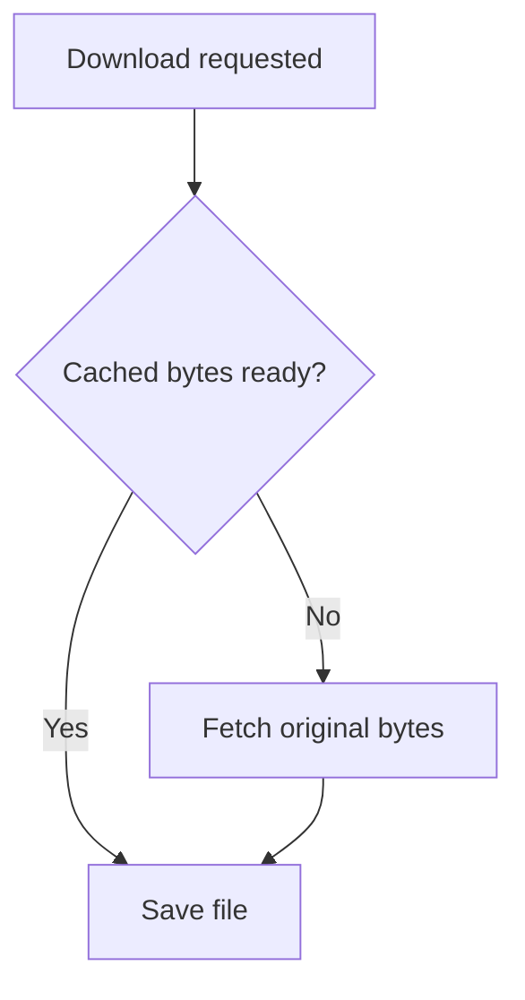
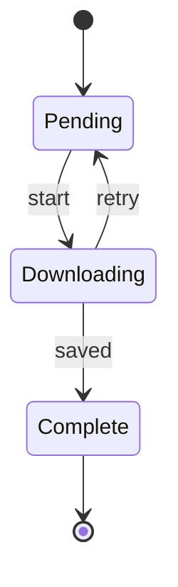

Flowcharts and state diagrams with Mermaid.

# Mermaid: flows and states

Use a `mermaid` fence. Pick a `flowchart` when the reader needs to follow actions
and decisions. Pick `stateDiagram-v2` when the reader needs to understand which
states are possible and which events cause transitions. If the project already
uses Mermaid and the point is message order, use `sequenceDiagram` instead of
trying to express the order in a flowchart.

## Workflow and branches

Use `flowchart TD` for top-down or `flowchart LR` for left-to-right layout. Give
nodes short IDs and readable labels. Label the outgoing edges of decisions with
the condition or outcome.

## State transitions

Label arrows with the event that changes state, not the name of the new state.
Use `[*]` for the initial or terminal point.

