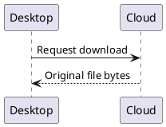
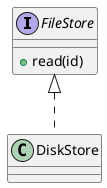

# PlantUML: interactions and type relationships

Use a `plantuml` or `uml` fence, with `@startuml` and `@enduml` inside it.
SeekMoon renders a subset of PlantUML; don't assume every extension or layout
option in the standalone renderer is available.

## Sequence diagram

Use a sequence diagram when the order of calls or responses matters. Declare the
participants, list messages from top to bottom, and label replies that affect
what happens next.

## Class diagram

Use a class diagram when the distinction between an interface, an implementation,
and their relationships is the point. Include only members relevant to the
question; use Diago (see `diagrams/diago`) for module-level dependencies instead.

